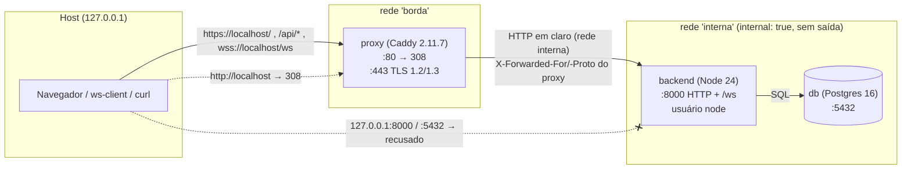

# Etapa 4a — TLS, proxy reverso e origem única

> Resolve o item **G** de [`01-baseline-seguranca.md`](01-baseline-seguranca.md)
> (tráfego HTTP/WS em texto claro). A criptografia ponta a ponta do conteúdo
> (item F) é a Etapa 4b. Arquivos: `proxy/Caddyfile`, `docker-compose.yml`,
> `scripts/export-ca.sh`, `scripts/verify-tls.sh`.

## 1. Objetivo e escopo

Até a Etapa 3, tudo trafegava em claro na rede (`http://`, `ws://`): a
senha do login, o cookie de sessão (suficiente para sequestrar a conta) e o
conteúdo das mensagens ([`03-protocolo.md`](03-protocolo.md) §11). Esta
etapa:

1. põe um **proxy reverso (Caddy)** na frente do backend, terminando o
   **TLS** com uma política explícita;
2. cria uma **origem pública única** (`https://localhost`): página, API e
   WebSocket sob o mesmo esquema, host e porta, o que simplifica CORS,
   cookie e a checagem de `Origin`;
3. tira o backend e o banco do alcance direto: **só o proxy** é publicado;
4. ajusta o backend para viver atrás de um proxy sem confiar em cabeçalho
   forjado (IP real no rate limit, cookie `Secure`).

Fora do escopo: E2EE (4b), frontend, certificado público (produção).

## 2. Topologia

| Serviço | Redes | Publicado no host | Observações |
|---|---|---|---|
| `proxy` | `borda`, `interna` | **127.0.0.1:80** e **127.0.0.1:443** | imagem fixada por tag **e digest**; `cap_drop: ALL` + `NET_BIND_SERVICE`; `no-new-privileges`; volumes `caddy_data` (CA, certificados, chaves) e `caddy_config` |
| `backend` | `interna` | **nada** | `NODE_ENV=production`, `TRUST_PROXY=1`, `CLIENT_URL=https://${PUBLIC_HOST}` |
| `db` | `interna` | **nada** (antes: 127.0.0.1:5432) | senha obrigatória (`--env-file backend/.env`) |

A rede `interna` é `internal: true`: o Docker não cria rota para fora, então
backend e banco **não acessam a internet** e **não podem ser publicados**
mesmo por engano. O único caminho de fora até o backend passa pelo proxy. O
Postgres de **teste** (`docker-compose.test.yml`, 127.0.0.1:5433) não muda.

## 3. Rotas da origem única

| Pedido do cliente | O proxy faz | O backend recebe |
|---|---|---|
| `http://localhost/<qualquer>` | **308** para `https://localhost/<mesmo caminho>` (permanente, preserva o método) | nada |
| `https://localhost/` | página estática provisória (`proxy/site/`) | nada |
| `https://localhost/api/<rota>` | encaminha **sem o prefixo** `/api` (`handle_path`); corpo limitado a 64 KB | `/<rota>` (ex.: `/login`, `/messages/7`) |
| `wss://localhost/ws` | encaminha o upgrade WebSocket | `/ws` |
| `https://localhost/api/ws` | **404** no próprio proxy | nada |

O Express não conhece `/api`: as rotas continuam as mesmas da Etapa 3, e
os testes não mudaram. O WebSocket fica na **raiz** (`/ws`), não em
`/api/ws`. Sem a regra explícita, o `handle_path /api/*` transformaria
`/api/ws` em `/ws`, criando um segundo caminho para o mesmo canal. Optei
por um caminho só. O cookie `sid` tem `Path=/`, então vale para `/api/*` e
para `/ws`.

## 4. Modelo de confiança dos certificados

## 5. Política TLS

## 6. Cabeçalhos de segurança: quem emite cada um

## 7. Backend atrás do proxy

## 8. O que mudou no modelo de ameaças

## 9. Limitação: o TLS termina no proxy

## 10. Wireshark: antes e agora

## 11. Como subir, exportar a CA e verificar

## 12. Decisões tomadas nesta etapa e pendências
