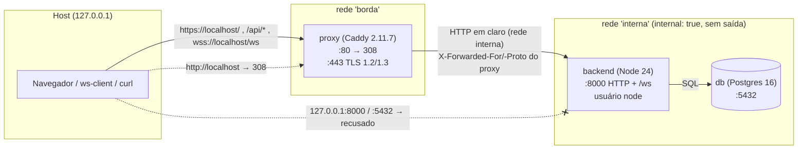

# Etapa 4a — TLS, proxy reverso e origem única

> Resolve o item **G** de [`01-baseline-seguranca.md`](01-baseline-seguranca.md)
> (tráfego HTTP/WS em texto claro). A criptografia ponta a ponta do conteúdo
> (item F) é a Etapa 4b. Arquivos: `proxy/Caddyfile`, `docker-compose.yml`,
> `scripts/export-ca.sh`, `scripts/verify-tls.sh`.

## 1. Objetivo e escopo

Até a Etapa 3, tudo trafegava em claro na rede (`http://`, `ws://`): a
senha do login, o cookie de sessão (suficiente para sequestrar a conta) e o
conteúdo das mensagens ([`03-protocolo.md`](03-protocolo.md) §11). Esta
etapa:

1. põe um **proxy reverso (Caddy)** na frente do backend, terminando o
   **TLS** com uma política explícita;
2. cria uma **origem pública única** (`https://localhost`): página, API e
   WebSocket sob o mesmo esquema, host e porta, o que simplifica CORS,
   cookie e a checagem de `Origin`;
3. tira o backend e o banco do alcance direto: **só o proxy** é publicado;
4. ajusta o backend para viver atrás de um proxy sem confiar em cabeçalho
   forjado (IP real no rate limit, cookie `Secure`).

Fora do escopo: E2EE (4b), frontend, certificado público (produção).

## 2. Topologia



| Serviço | Redes | Publicado no host | Observações |
|---|---|---|---|
| `proxy` | `borda`, `interna` | **127.0.0.1:80** e **127.0.0.1:443** | imagem fixada por tag **e digest**; `cap_drop: ALL` + `NET_BIND_SERVICE`; `no-new-privileges`; volumes `caddy_data` (CA, certificados, chaves) e `caddy_config` |
| `backend` | `interna` | **nada** | `NODE_ENV=production`, `TRUST_PROXY=1`, `CLIENT_URL=https://${PUBLIC_HOST}` |
| `db` | `interna` | **nada** (antes: 127.0.0.1:5432) | senha obrigatória (`--env-file backend/.env`) |

A rede `interna` é `internal: true`: o Docker não cria rota para fora, então
backend e banco **não acessam a internet** e **não podem ser publicados**
mesmo por engano. O único caminho de fora até o backend passa pelo proxy. O
Postgres de **teste** (`docker-compose.test.yml`, 127.0.0.1:5433) não muda.

## 3. Rotas da origem única

| Pedido do cliente | O proxy faz | O backend recebe |
|---|---|---|
| `http://localhost/<qualquer>` | **308** para `https://localhost/<mesmo caminho>` (permanente, preserva o método) | nada |
| `https://localhost/` | página estática provisória (`proxy/site/`) | nada |
| `https://localhost/api/<rota>` | encaminha **sem o prefixo** `/api` (`handle_path`); corpo limitado a 64 KB | `/<rota>` (ex.: `/login`, `/messages/7`) |
| `wss://localhost/ws` | encaminha o upgrade WebSocket | `/ws` |
| `https://localhost/api/ws` | **404** no próprio proxy | nada |

O Express não conhece `/api`: as rotas continuam as mesmas da Etapa 3, e
os testes não mudaram. O WebSocket fica na **raiz** (`/ws`), não em
`/api/ws`. Sem a regra explícita, o `handle_path /api/*` transformaria
`/api/ws` em `/ws`, criando um segundo caminho para o mesmo canal. Optei
por um caminho só. O cookie `sid` tem `Path=/`, então vale para `/api/*` e
para `/ws`.

## 4. Modelo de confiança dos certificados

**Desenvolvimento: `tls internal` (CA local do Caddy).** No primeiro uso, o
Caddy cria a própria autoridade certificadora no volume `caddy_data`:

| Peça | Validade | Onde fica |
|---|---|---|
| raiz "Caddy Local Authority - 2026 ECC Root" | 10 anos | `root.crt` (público) + **`root.key` (privada)** |
| intermediária | 7 dias, renovada sozinha | `intermediate.crt` + `intermediate.key` |
| certificado de `localhost` | horas, renovado sozinho | no armazenamento do Caddy |

Nenhum cliente confia nessa CA por padrão, e é isso que se quer: quem
quiser falar com `https://localhost` precisa confiar **explicitamente** na
raiz. `scripts/export-ca.sh` exporta só o `root.crt` para `certs/` (fora do
git) e mostra o fingerprint SHA-256. A raiz é diferente em cada máquina
(cada volume gera a sua). O cliente então usa:

- `curl --cacert certs/caddy-local-root.crt …`
- `node backend/tools/ws-client.js --ca certs/caddy-local-root.crt …`, ou
  `NODE_EXTRA_CA_CERTS=certs/caddy-local-root.crt`
- navegador: importar a raiz **num perfil de testes** (ver o risco abaixo).

A verificação do certificado **nunca é desligada**: não há `--insecure` no
ws-client, e o `verify-tls.sh` prova que, sem a CA, o `curl` recusa.

**Risco da CA local.** Quem tiver o `root.key` emite certificados aceitos
por **qualquer** cliente que confie nessa raiz, para qualquer domínio, não
só `localhost`. Por isso:

- a chave nunca sai do volume: `export-ca.sh` recusa exportar arquivo com
  `PRIVATE KEY`, e o `.gitignore` cobre `certs/`, `caddy_data/`, `*.key`,
  `*.pem` e `*.crt` (conferido com `git ls-files` antes de cada commit);
- não instale a raiz no repositório de confiança **do sistema**; prefira
  `--cacert` por ferramenta ou um perfil de navegador só para o projeto;
- `docker compose down -v` apaga o volume e, com ele, a CA. Uma CA nova
  exige exportar de novo.

**Produção: Let's Encrypt (ACME).** Com um domínio real em `PUBLIC_HOST`, o
Caddy obtém e renova sozinho um certificado de uma CA pública, na qual os
navegadores já confiam. A troca é tirar `internal` da diretiva (mantendo
`protocols`, `ciphers` e `curves`) e informar um e-mail de contato. O
desafio ACME (HTTP-01 na porta 80 ou TLS-ALPN-01 na 443) exige essas portas
**acessíveis pela internet**, e hoje elas só escutam em 127.0.0.1. Fica
para a implantação (Etapa 6).

## 5. Política TLS

Explícita no `proxy/Caddyfile`, para não depender dos padrões do Caddy ou
do Go, que mudam entre versões:

| Item | Configuração | Por quê |
|---|---|---|
| Versões | `protocols tls1.2 tls1.3` | TLS 1.0/1.1 estão obsoletos (RFC 8996: SHA-1 no handshake, sem AEAD). O 1.2 fica para clientes antigos; o **1.3 é negociado sempre que o cliente suporta** (versão mais alta comum), com handshake mais curto e tudo cifrado após o ServerHello. |
| Suítes do TLS 1.2 | só `ECDHE-{ECDSA,RSA}-{AES-256-GCM, CHACHA20-POLY1305, AES-128-GCM}` | **ECDHE**: sigilo futuro (forward secrecy; vazar a chave do certificado depois não decifra capturas antigas). **AEAD** (GCM/ChaCha20): sem CBC (Lucky13/POODLE), sem RSA estático, 3DES ou RC4. As suítes RSA ficam para o caso de certificado RSA em produção. |
| Suítes do TLS 1.3 | as do protocolo (AES-GCM, ChaCha20) | Todas são AEAD com sigilo futuro; o Go não permite configurá-las. |
| Curvas (troca de chaves) | `x25519mlkem768 x25519 secp256r1 secp384r1` | X25519MLKEM768 é a **híbrida pós-quântica** (protege contra "capturar agora, decifrar depois"); o Go a usa por padrão, e listá-la evita perdê-la ao restringir as curvas. X25519 e P-256/P-384 cobrem os demais clientes. |
| HTTP/3 | desligado (`protocols h1 h2` no servidor) | Só 443/TCP é publicado; com HTTP/3, o `Alt-Svc` anunciaria um 443/UDP inexistente. |
| HTTP → HTTPS | `redir … 308` | Permanente e preserva o método (um POST não vira GET). |

Prova (`verify-tls.sh`, com `openssl s_client`):

- TLS 1.1 → o **servidor** responde com o alerta *protocol version*. O
  cliente oferece 1.1 com `SECLEVEL=0`, para a recusa não ser do próprio
  OpenSSL.
- TLS 1.2 → `ECDHE-ECDSA-AES128-GCM-SHA256`.
- TLS 1.3 → `TLS_AES_128_GCM_SHA256`.
- TLS 1.2 oferecendo só CBC ou RSA estático → recusado.

## 6. Cabeçalhos de segurança: quem emite cada um

Regra: **o proxy emite o que depende do transporte e vale para a origem
inteira; o backend emite o que depende do conteúdo das respostas da API.**
Assim nenhum cabeçalho sai duplicado ou com dois valores.

| Cabeçalho | Página `/` | API `/api/*` | Quem emite |
|---|---|---|---|
| `Strict-Transport-Security: max-age=31536000; includeSubDomains` | ✓ | ✓ | **proxy** (o helmet do backend está com HSTS desligado) |
| `Server` | removido | removido | **proxy** (`-Server`, também no 308 do HTTP); o Express não envia |
| `X-Powered-By` | — | removido | backend (helmet) |
| `X-Content-Type-Options: nosniff` | ✓ | ✓ | proxy na página; **helmet** na API |
| `Referrer-Policy: no-referrer` | ✓ | ✓ | proxy na página; **helmet** na API |
| `Content-Security-Policy` | `default-src 'none'; base-uri 'none'; form-action 'none'; frame-ancestors 'none'` | padrão do helmet | proxy na página; **helmet** na API |

A CSP da página é a mais restritiva possível porque a página é HTML puro,
sem script, estilo nem imagem. Ela precisará ser revista quando o frontend
real for servido daqui. O `max-age` de 1 ano com `includeSubDomains` é o
recomendado; o `preload` não foi incluído porque exige domínio público e
inscrição na lista dos navegadores.

## 7. Backend atrás do proxy

- **`trust proxy` com o número exato de saltos.** `TRUST_PROXY=1` no
  compose: o Express usa como IP do cliente o último endereço que o
  **Caddy** acrescentou ao `X-Forwarded-For`, e ignora o que vier à
  esquerda. Só inteiros ≥ 1 são aceitos; `true`, `loopback`, `0` ou listas
  impedem o servidor de subir (`backend/app.js`, `tests/proxy.test.js`).
  Com `true`, o cliente escolheria o próprio IP no rate limit.
- **O Caddy não repassa o `X-Forwarded-For` do cliente.** Sem
  `trusted_proxies`, ele **sobrescreve** o `X-Forwarded-For`,
  `-Proto` e `-Host` com o que vê na conexão. Como o backend só é
  alcançável pelo proxy (§2), não há como chegar a ele com um cabeçalho
  forjado. Prova: `verify-tls.sh` manda dois `X-Forwarded-For` diferentes e
  o `RateLimit-Remaining` cai de 1 (mesmo balde).
- **Rate limit HTTP** (`/register`, `/login`): chaveado pelo IP real
  (acima) e, no login, também pela conta.
- **WebSocket**: o upgrade agora tem um limite de **tentativas por IP real**
  (rajada de 20, reposição de 0,5/s), conferido **antes** de ler a sessão no
  banco (protege contra inundação sem sessão). O IP é calculado com
  `proxy-addr` e a mesma função de confiança do Express
  (`app.get("trust proxy fn")`). Os limites por usuário (5 conexões), total
  (1000) e o rate limit por conexão continuam como na Etapa 3
  (`tests/ws/upgradeIp.test.js`).
- **Cookie `sid` com `Secure`.** `NODE_ENV=production` no compose liga o
  `secure: true`; o express-session só emite o cookie quando o proxy informa
  `X-Forwarded-Proto: https`. Se a requisição chegou por HTTP, não há cookie
  (`tests/proxy.test.js`).
- **`CLIENT_URL=https://${PUBLIC_HOST}`** (padrão `https://localhost`):
  é a origem do CORS e a comparada no `Origin` do upgrade do `/ws`. Com
  origem única, página e API são *same-origin* e o CORS quase não entra em
  jogo. A checagem de `Origin` do `/ws` continua essencial (CSWSH).
- O `backend/.env` continua servindo para rodar **fora** do Docker (HTTP,
  `NODE_ENV=development`, `CLIENT_URL=http://localhost:3000`). O compose
  sobrescreve esses valores.

## 8. O que mudou no modelo de ameaças

| Ameaça ([`00-modelo-ameacas.md`](00-modelo-ameacas.md)) | Antes (Etapa 3) | Agora (4a) | Prova |
|---|---|---|---|
| **Atacante na rede** lê senha, cookie e mensagens | tudo em claro | cifrado com TLS 1.2/1.3 e sigilo futuro | §10; `verify-tls.sh` (versões e suítes) |
| Atacante na rede **sequestra a sessão** com o cookie capturado | cookie em claro | cookie só por HTTPS (`Secure`), `HttpOnly` e `SameSite` | `verify-tls.sh`, `tests/proxy.test.js` |
| **Rebaixamento para HTTP** (SSL stripping) | — | 308 para HTTPS + HSTS de 1 ano: depois da 1ª visita, o navegador nem tenta HTTP | `verify-tls.sh` |
| **Homem no meio com certificado falso** | — | o cliente verifica o certificado (sem modo inseguro); só a CA local (dev) ou pública (prod) é aceita | `verify-tls.sh`, `tests/tools/wsClientTls.test.js` |
| Cliente rebaixa `wss://` → `ws://` e manda o cookie em claro | — | o ws-client recusa `ws://` com API `https://` | `tests/tools/wsClientTls.test.js` |
| **Acesso direto** ao backend ou ao banco, contornando o proxy | 127.0.0.1:8000 e :5432 abertos | sem portas no host; rede interna sem saída | `verify-tls.sh` |
| **IP forjado** (`X-Forwarded-For`) para fugir do rate limit | sem proxy, não se aplicava | o Caddy sobrescreve; `trust proxy` = 1 salto exato | `verify-tls.sh`, `tests/proxy.test.js`, `tests/ws/upgradeIp.test.js` |
| **Inundação de upgrades** sem sessão (custa banco) | ilimitada | 20 de rajada + 0,5/s por IP real, antes do banco | `tests/ws/upgradeIp.test.js` |
| **Cross-Site WebSocket Hijacking** | `Origin` = `http://localhost:3000` | `Origin` = `https://localhost` (origem única) | `verify-tls.sh`, `tests/ws/upgrade.test.js` |
| **Comprometimento do proxy** | — | **novo ativo crítico**: a chave da CA local e o texto em claro passam por ele (§9) | — |

Novos ativos a proteger: a **chave privada da CA local** (volume
`caddy_data`) e o próprio **proxy** (vê tudo em claro). Contêiner do proxy
sem capabilities extras, `no-new-privileges` e imagem fixada por digest.

## 9. Limitação: o TLS termina no proxy

O TLS protege o **trajeto** cliente ↔ proxy, e só ele:

- O Caddy **decifra** tudo. Do proxy ao backend, na rede `interna` do
  Docker, o tráfego segue em **HTTP puro**, aceitável só porque essa rede
  fica dentro da mesma máquina e não é publicada. Num ambiente com proxy e
  backend em máquinas diferentes, esse trecho precisaria de TLS próprio
  (ou mTLS).
- O **proxy, o backend e o banco veem o texto em claro**: senha no login,
  `body` das mensagens (gravado em claro na coluna `messages.message`),
  quem fala com quem. O **administrador do servidor**, o ator mais
  importante do modelo de ameaças, **continua lendo tudo**. O TLS não
  muda nada para ele.
- Só a **E2EE da Etapa 4b** protege o conteúdo contra o administrador: o
  `body` sairá cifrado do cliente e o servidor nunca terá a chave. Mesmo
  assim, os **metadados** continuarão visíveis ao servidor
  ([`03-protocolo.md`](03-protocolo.md) §9).
- Com `tls internal`, a confiança depende de cada cliente importar a raiz
  certa. Um atacante que convença o usuário a importar a raiz **dele**
  (engenharia social) ganha um homem no meio, risco fora do modelo
  (Etapa 0, §5).

## 10. Wireshark: antes e agora

Passos (compare com [`03-protocolo.md`](03-protocolo.md) §11):

1. Suba a stack e exporte a CA (§11). Abra o Wireshark na interface
   **`lo`** (cliente → `127.0.0.1:443`, passando pelo `docker-proxy`), com
   filtro de captura `tcp port 443 or tcp port 80`.
2. Rode o cliente de referência e mande uma mensagem:
   `CHAT_PASSWORD=… node backend/tools/ws-client.js --server https://localhost/api --ca certs/caddy-local-root.crt --origin https://localhost --email … --room …`
3. Filtros de exibição: **`tls`** (registros TLS), `tls.handshake` (só o
   handshake), `http` (só o 308 da porta 80).

**O que se vê agora:**

- **ClientHello** em claro: versões oferecidas, suítes, curvas
  (inclusive `X25519MLKEM768`), ALPN (`h2`, `http/1.1`) e o **SNI
  `localhost`** (nome do servidor; o ECH, que o esconderia, não está em uso).
- **ServerHello**: versão e suíte escolhidas. No TLS 1.3, o certificado e o
  restante do handshake já vão **cifrados**. No TLS 1.2, o certificado
  aparece em claro.
- Depois disso, só registros **`Application Data`** opacos: login, cookie,
  upgrade do `/ws`, `HELLO`, `MSG_SEND`, `body`… **nada legível**.
  *Follow → TLS Stream* não mostra o conteúdo.
- Na porta 80, só o `308` para HTTPS, sem dados da aplicação (a não ser
  que um cliente mande dados por HTTP antes de ser redirecionado; o HSTS
  evita isso no navegador a partir da segunda visita).

**O que continua visível (metadados de rede):** IPs e portas de origem e
destino, o SNI, os **tamanhos** dos registros (dá para estimar o tamanho
de cada mensagem) e os **horários** (quando alguém escreve, de quanto em
quanto tempo, o ping de controle a cada 30 s). O TLS esconde o conteúdo,
não o padrão do tráfego.

**Ainda em claro, de propósito:** capturando na interface da **rede
`interna`** do Docker (`br-…`), o trecho proxy → backend aparece em HTTP
puro (§9). É uma boa demonstração de onde o TLS termina.

**Para a apresentação (opcional):** o Node grava as chaves de sessão TLS
com `node --tls-keylog=chaves.log backend/tools/ws-client.js …`. Configurado
em *Preferences → Protocols → TLS → (Pre)-Master-Secret log filename*, o
Wireshark decifra a **própria** captura e mostra que o conteúdo está lá.
Esse arquivo é tão sensível quanto o tráfego: não commitar e apagar depois.

| Momento | Etapa 3 (`ws://`) | Etapa 4a (`wss://`) |
|---|---|---|
| `POST /login` | senha em claro | cifrado (Application Data) |
| Cookie `sid` | em claro | cifrado; `Secure` impede envio por HTTP |
| Upgrade `/ws` | cabeçalhos em claro | cifrado |
| `MSG_SEND.body` / `MSG_DELIVER.body` | texto em claro | cifrado **na rede**; em claro no proxy, no backend e no banco |
| Nome do servidor | `Host` em claro | SNI em claro |
| IPs, portas, tamanhos, horários | visíveis | visíveis |

## 11. Como subir, exportar a CA e verificar

```bash
cp backend/.env.example backend/.env       # e preencha SESSION_SECRET e DB_PASSWORD
docker compose --env-file backend/.env up --build -d
scripts/export-ca.sh                       # → certs/caddy-local-root.crt (fora do git)
scripts/verify-tls.sh                      # 28 provas; sai com != 0 se alguma falhar
curl --cacert certs/caddy-local-root.crt https://localhost/api/health
docker compose --env-file backend/.env down   # sem -v: preserva o banco e a CA
```

- Sem `--env-file`, o compose se recusa a subir (`DB_PASSWORD` é
  obrigatório).
- `PUBLIC_HOST` (opcional, padrão `localhost`) define o nome do site no
  Caddyfile e o `CLIENT_URL` do backend.
- O `verify-tls.sh` cria e **apaga** um usuário e uma sala temporários e
  gasta 5 tentativas do limite de `/register` e `/login` por IP (20 a cada
  15 min).
- Os testes automatizados (`cd backend && npm test`) continuam rodando
  contra o Postgres de teste na porta 5433, sem a stack.

## 12. Decisões tomadas nesta etapa e pendências

Decisões que a especificação deixava em aberto (escolhida a opção mais
segura):

| Decisão | Escolha | Alternativa descartada |
|---|---|---|
| HSTS | só no proxy; helmet com HSTS desligado | emitir nos dois (cabeçalho duplicado) |
| `/api/ws` | 404 no proxy | aceitar dois caminhos para o mesmo canal |
| HTTP/3 | desligado | anunciar 443/UDP não publicado |
| Curvas | incluir a híbrida pós-quântica X25519MLKEM768 | só X25519/P-256 (perderia a proteção PQ do padrão do Go) |
| `TRUST_PROXY` inválido | servidor não sobe | ignorar ou aceitar nomes/listas |
| Limite por IP no `/ws` | **tentativas** de upgrade por IP real, antes do banco | limite de conexões **simultâneas** por IP (puniria usuários atrás do mesmo NAT, como a rede do campus) |
| Rede do backend/banco | `internal: true` (sem saída) | rede comum (backend com acesso à internet sem necessidade) |
| Imagem do Caddy | tag **e** digest | só a tag (pode ser republicada) |
| ws-client com `--ca` | CA **somada** às do sistema | substituir as do sistema (quebraria Let's Encrypt) |
| ws-client e redirecionamento | não segue 308 (erro) | seguir e reenviar a senha sozinho |
| ws-client `https` + `ws://` | recusado antes do login | permitir (cookie em claro) |

**Pendências**

1. **Produção:** domínio real, `PUBLIC_HOST` e Let's Encrypt (§4); abrir
   80/443 para a internet e firewall (Etapa 6).
2. **Frontend:** servido pelo proxy na mesma origem; rever a CSP (§6).
3. **Proxy ↔ backend sem TLS** na rede interna: aceitável numa máquina só,
   não em implantação distribuída (§9).
4. **Logs de acesso do Caddy** estão desligados (padrão do Caddyfile sem
   `log`). Ligar exigiria cuidado com IPs e caminhos (metadados, Etapa 5).
5. **HSTS preload** e **ECH** (esconder o SNI) dependem de domínio público
   e ficam para depois.
6. Limites do rate limit continuam **em memória** (uma instância).
